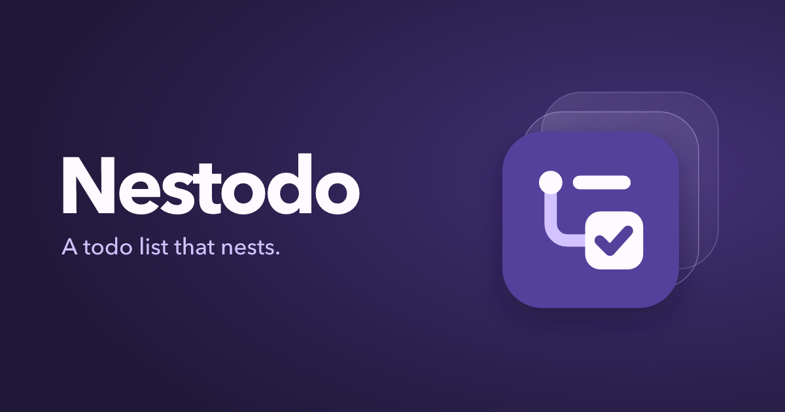

# Nestodo

A todo list for my family. Each member signs in through Cloudflare Access and sees only their own todos.

I publish the code as it is. There is no public instance to sign up for, and no guide to running your own copy.

- Nest todos into an outline and collapse the parts you are not working on.
- See what you added and completed each day on the stats page.
- Completed todos leave the list 8 days after they were completed and are kept in an archive.

## Apps

- [Web](apps/web/README.md): use it in the browser or install it as a desktop app.
- [Android](apps/android/README.md)
- [CLI](apps/cli/README.md): manage todos from the terminal.

## MCP

Add `https://<your MCP host>/mcp` to an AI assistant as a remote MCP server, such as a custom connector in Claude, to let it list, add, edit and complete your todos and read your stats.

## Development

See [CONTRIBUTING.md](CONTRIBUTING.md).
